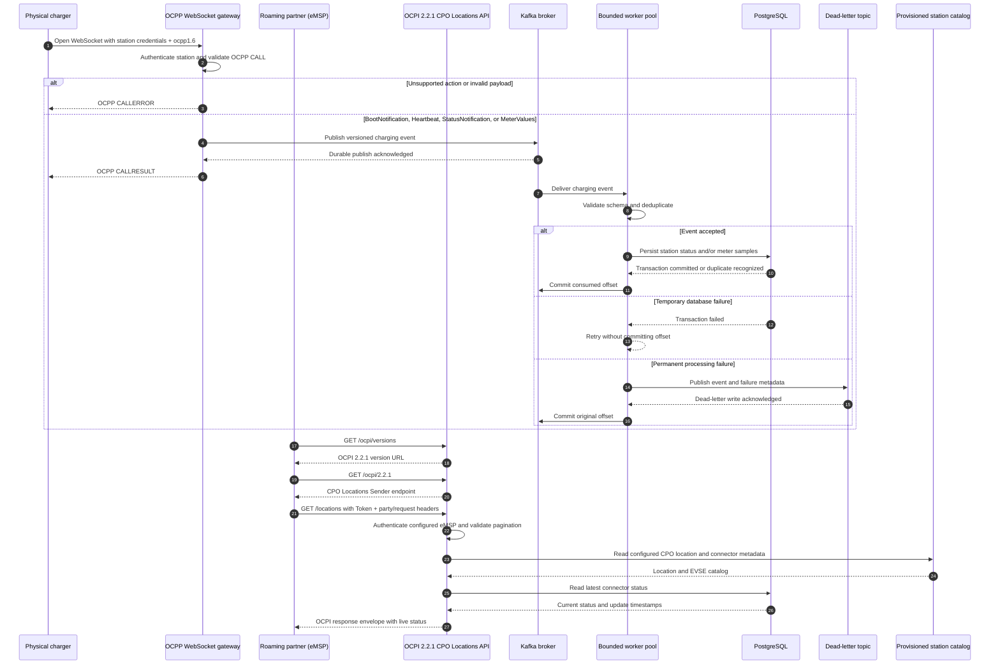

# EV Charging Device Ingestion Platform

The platform accepts telemetry over HTTP (`:8080`) and gRPC (`:50051`), and
charging station events over OCPP 1.6J WebSockets (`:8081`). It exposes OCPI
2.2.1 Locations to roaming partners over HTTP. Events are published to Kafka
and persisted in PostgreSQL; ingestion requests are acknowledged after Kafka
confirms the write, and consumer offsets are committed only after database
writes succeed. Telemetry validation rejects missing or oversized device IDs,
non-finite measurements, and negative measurements before publishing.

Telemetry is stored in PostgreSQL by a bounded connection pool. Each insert
runs in a transaction at `READ COMMITTED`; a unique `(device_id,
idempotency_key)` constraint makes Kafka redelivery and client retries safe.
Reusing a key with different measurements sends the record to the DLQ. Kafka
offsets are committed only after the PostgreSQL transaction or DLQ write
succeeds. PostgreSQL provides durability through its WAL.

Because telemetry rows are append-only, the writer does not update shared rows
and does not need optimistic version checks or `SELECT FOR UPDATE`. The unique
constraint arbitrates concurrent retries safely. `DB_MAX_OPEN_CONNS` bounds
each process's PostgreSQL pool (maximum 32); size that pool and
`KAFKA_DB_WORKERS` against the total connection budget across service replicas.
The default pool size is `min(KAFKA_DB_WORKERS, 16)`. PostgreSQL is a
downstream consumer: the gateway can continue acknowledging Kafka-persisted
events while the database is unavailable, and the consumer retries without
committing offsets.

`make reconcile` replays the retained `device.telemetry` topic into PostgreSQL;
set `RECONCILE_CHARGING=true` to replay `charging.events` instead. Both use the
same idempotent repositories as the live workers. Reconciliation uses a
bounded worker count (`RECONCILE_WORKERS`, default 2) and does not change the
live consumer group's offsets. Each run scans retained topic history, so
schedule it at a cadence and time that fit the topic's size and database
capacity. Data older than Kafka retention cannot be repaired by replay.

## Architecture

The project follows ports and adapters (Hexagonal Architecture):

- `internal/domain` contains telemetry types without infrastructure dependencies.
- `internal/application` contains ingestion and processing use cases plus the
  publisher and repository ports they need.
- `internal/adapters/httpapi` and `internal/adapters/grpcapi` translate inbound
  requests into application calls.
- `internal/adapters/ocppapi` handles configured OCPP 1.6J WebSocket stations;
  `internal/adapters/ocpiapi` exposes the OCPI 2.2.1 CPO Locations Sender API
  for configured eMSP partners.
- `internal/adapters/kafka` implements the publisher port and runs Kafka
  consumers for both generic telemetry and normalized charging events.
- `internal/adapters/persistence/postgres` implements the repository port and
  applies versioned PostgreSQL migrations. Charging connector status is stored
  separately from append-only meter samples.
- `app` is the composition root: it selects adapters, connects them to the
  application, and manages server startup and shutdown.
- `cmd/server` loads configuration and starts the app.

Dependencies point inward: adapters depend on application and domain packages;
the domain has no dependencies on transports, Kafka, or persistence.

## Charging platform event sequence



The initial protocol slice supports OCPP 1.6J `BootNotification`, `Heartbeat`,
`StatusNotification`, and `MeterValues`, plus OCPI 2.2.1 version discovery and
the CPO `Locations` Sender interface. OCPP connector metadata and station
credentials are provisioned through `OCPP_STATIONS` JSON configuration; eMSP
party tokens use `OCPI_EMSP_PARTNERS`. The OCPI Credentials registration
handshake, OCPI Tokens/Sessions/CDRs/Commands modules, and OCPP remote control
are not included in this initial slice.

Example configuration (store passwords and tokens in the deployment secret
manager; these values are placeholders):

```sh
export OCPI_CPO_COUNTRY_CODE=US
export OCPI_CPO_PARTY_ID=ABC
export OCPI_BASE_URL=https://cpo.example.com
export OCPP_STATIONS='[{"id":"charger-001","password":"replace-with-secret","location_id":"site-001","name":"Main Street","address":"1 Main Street","city":"Example City","postal_code":"10000","country":"USA","latitude":40.7128,"longitude":-74.0060,"time_zone":"America/New_York","connectors":[{"connector_id":1,"evse_uid":"EVSE-001","standard":"IEC_62196_T1","format":"SOCKET","power_type":"AC_1_PHASE","max_voltage":230,"max_amperage":32,"max_electric_power":7360}]}]'
export OCPI_EMSP_PARTNERS='[{"country_code":"CA","party_id":"XYZ","token":"replace-with-partner-token"}]'
```

The OCPP listener defaults to `:8081`. Configure trusted TLS termination in
front of both public protocol endpoints for production. The Docker Compose
startup creates the Kafka topics and applies the additive PostgreSQL schema
before it starts the app.

To disable OCPP station ingress during rollback, remove `OCPP_STATIONS` from
the deployment configuration and restart the service. To disable OCPI access,
remove `OCPI_EMSP_PARTNERS`; the additive charging tables and retained Kafka
topics can remain for replay and diagnosis.

## Kafka setup

Set `KAFKA_BROKERS` to comma-separated bootstrap addresses. Before starting the
service, create `device.telemetry` and `device.telemetry.dlq` for the existing
ingestion API, and `charging.events` plus `charging.events.dlq` for OCPP events.
For
production, use a replication factor of at least 3 and
`min.insync.replicas=2`; the producer waits for all in-sync replicas. Keep
retention long enough to cover database outages and recovery. Use enough
partitions for the desired consumer parallelism. Records are keyed by device ID
to preserve per-device partition ordering.

For example, on a three-broker Kafka cluster:

```sh
kafka-topics.sh --bootstrap-server "$KAFKA_BROKERS" \
  --create --if-not-exists --topic device.telemetry \
  --partitions 12 --replication-factor 3 \
  --config min.insync.replicas=2 \
  --config retention.ms=604800000

kafka-topics.sh --bootstrap-server "$KAFKA_BROKERS" \
  --create --if-not-exists --topic device.telemetry.dlq \
  --partitions 3 --replication-factor 3 \
  --config min.insync.replicas=2 \
  --config retention.ms=2592000000

kafka-topics.sh --bootstrap-server "$KAFKA_BROKERS" \
  --create --if-not-exists --topic charging.events \
  --partitions 12 --replication-factor 3 \
  --config min.insync.replicas=2 \
  --config retention.ms=604800000

kafka-topics.sh --bootstrap-server "$KAFKA_BROKERS" \
  --create --if-not-exists --topic charging.events.dlq \
  --partitions 3 --replication-factor 3 \
  --config min.insync.replicas=2 \
  --config retention.ms=2592000000
```

## Run with Docker Compose

With Docker Desktop (or Docker Engine and the Compose plugin) running, start the
app, Kafka, PostgreSQL, Kafka topics, and database migrations with one command:

```sh
make compose-up
```

This stops any running legacy containers named `device-ingestion-kafka` and
`device-ingestion-postgres` before Compose claims their ports. The containers
are stopped but kept on disk; PostgreSQL data remains in the named
`device-ingestion-postgres-data` volume. Compose waits for Kafka and PostgreSQL,
creates the four application topics, applies migrations, then starts the app.
Kafka is available to host tools at `localhost:9092`, PostgreSQL at
`localhost:5432`, HTTP/OCPI at `localhost:8080`, OCPP at `localhost:8081`, and
gRPC at `localhost:50051`.

## Health-only sandbox profile

For a Kubernetes exercise that does not provision Kafka or PostgreSQL, start
the service with `APP_PROFILE=sandbox`. This profile starts only the HTTP and
gRPC listeners. `/health/live` and `/health/ready` report process health;
`/health/dependencies` returns HTTP 503 because Kafka and PostgreSQL are
disabled. Data ingestion, OCPI, metrics, and other HTTP operations return HTTP
503, and ingestion gRPC calls return `Unavailable`. The profile never reports
an ingestion request as accepted or persisted. The default `full` profile
continues to require Kafka and PostgreSQL.

## Container validation

GitHub Actions builds the image for `linux/amd64`, labels it with the source
commit, verifies the non-root image user, and starts it in sandbox mode for
health and unavailable-route checks. Trivy scans the built image and CI fails
for fixable HIGH or CRITICAL vulnerabilities. A CycloneDX SBOM is uploaded as a
workflow artifact and retained for seven days. This validation job does not use
AWS credentials or publish to the sandbox ECR repository. Pushes and pull
requests run CI validation only; neither trigger AWS access, image publishing,
or Kubernetes deployment. Staging deployment is a separate manual workflow
and requires selecting its explicit AWS deployment confirmation input. CI uses
GitHub-hosted runner time and artifact storage, which may count toward the
repository's GitHub Actions quota or billing; it makes no AWS resource calls.

View service status and logs:

```sh
docker compose ps
docker compose logs -f app
```

List every Kafka topic:

```sh
docker compose exec kafka /opt/kafka/bin/kafka-topics.sh \
  --bootstrap-server localhost:9092 --list
```

Stop and remove the Compose containers while keeping the PostgreSQL volume:

```sh
make compose-down
```

To also delete the PostgreSQL database volume and its data, run
`docker compose down --volumes`.

On first startup, `make compose-up` copies `.env.example` to the git-ignored
`.env` if one does not exist. It includes a local OCPP station, so WebSocket
ingress starts at `ws://localhost:8081/ocpp/charger-001`; the sample password is
`local-test-password`. It also enables an example eMSP partner for authenticated
OCPI Locations requests. Edit `.env` to change these local settings. These
credentials are for development only; use a deployment secret manager outside
development. Recreate the app after changing configuration with
`docker compose up --build -d app`.

The repository includes vendored Go dependencies, so the application image
build does not need to download Go modules. Use `make run`, `make kafka-up`,
`make kafka-topics`, `make postgres-up`, and `make migrate` only when you want to
run the app directly on the host instead of using Compose.

## Deploy to Kubernetes with Minikube

The Minikube profile deploys the same Helm chart used for the AWS pilot, with
local Kafka and PostgreSQL dependencies, Kubernetes Secrets, and no AWS
ingress. It runs Kafka topic initialization, database migrations, and the
protocol/persistence smoke checks inside the cluster.

Requirements: Docker Desktop (running), Minikube, kubectl, and Helm 3. Create
the local credentials file once, then start the profile:

```sh
cp deploy/kubernetes/minikube/credentials.env.example \
  deploy/kubernetes/minikube/credentials.env
make minikube-up
```

When the script reports success, access the HTTP, OCPP, and gRPC services from
your host with:

```sh
kubectl --context device-ingestion -n device-ingestion-staging \
  port-forward svc/device-ingestion 8080:8080 8081:8081 50051:50051
```

The endpoints are `http://localhost:8080`,
`ws://localhost:8081/ocpp/<station-id>`, and `localhost:50051` (plaintext
gRPC). Stop the cluster with `make minikube-down`. See
[`docs/minikube-deployment.md`](docs/minikube-deployment.md) for troubleshooting
and detailed commands.

## Deploy to AWS staging

The repository includes Terraform infrastructure and a GitHub Actions OIDC
workflow for an isolated AWS EKS staging pilot. Pushes do not deploy. Staging
deployment requires manual dispatch with an explicit confirmation because it
uses AWS and may incur charges. The deployment covers HTTP/OCPI, OCPP
WebSockets, and gRPC, backed by private MSK and RDS PostgreSQL. See
[the AWS EKS staging guide](docs/aws-staging-deployment.md) for cluster
add-ons, prerequisites, secret setup, Terraform commands, GitHub environment
configuration, smoke checks, rollback, and teardown.

Set `KAFKA_DB_WORKERS` to control the number of consumer group members. It must
be between 1 and 32, and should not exceed the input topic partition count for
useful parallelism. Each worker processes one message at a time; the Kafka
reader queue holds at most one additional message, and each broker fetch is
limited to 1 MiB. This caps concurrent repository calls at the worker count
and keeps the in-memory backlog bounded while Kafka retains remaining records
during slowdowns. The single-node Docker broker is for local development;
production should use a replicated Kafka cluster.

Run a repair pass manually or schedule it with your job runner:

```sh
make reconcile
```

## Profiling with pprof

The service exposes Go's pprof handlers on a separate listener at
`127.0.0.1:6060` by default. Keep this listener on loopback unless access is
restricted by your network environment. Set `PPROF_ADDRESS` to change it; for
example, use `:6060` in a container and publish or forward that port only to a
trusted local machine.

With the service running, collect a 30-second CPU profile and inspect the
highest-cost functions:

```sh
go tool pprof -top 'http://localhost:6060/debug/pprof/profile?seconds=30'
```

Inspect current heap allocations:

```sh
go tool pprof -top http://localhost:6060/debug/pprof/heap
```

List goroutine stacks:

```sh
curl -s 'http://localhost:6060/debug/pprof/goroutine?debug=2' | less
```

For interactive exploration, omit `-top` from the `go tool pprof` command.
Available profiles are listed at `http://localhost:6060/debug/pprof/`.

## Send test telemetry

Send a packet over HTTP:

```sh
curl -i http://localhost:8080/telemetry \
  -H "Content-Type: application/json" \
  -H "Idempotency-Key: charger-ev-001-telemetry-0001" \
  -d '{"device_id":"charger-ev-001","voltage":230.5,"current":16.0,"power_kw":3.68}'
```

Or send it over gRPC with `grpcurl` installed:

```sh
grpcurl -plaintext \
  -import-path . \
  -proto proto/telemetry.proto \
  -d '{"deviceId":"charger-ev-001","voltage":230.5,"current":16.0,"powerKw":3.68,"idempotencyKey":"charger-ev-001-telemetry-0001"}' \
  localhost:50051 ingestion.IngestionService/IngestTelemetry
```

Both should return a queued response after Kafka acknowledges the write. To
inspect records, run:

```sh
docker compose exec kafka \
  /opt/kafka/bin/kafka-console-consumer.sh \
  --bootstrap-server localhost:9092 \
  --topic device.telemetry \
  --from-beginning
```

## Test OCPI and OCPP

Run these commands from another terminal while `make compose-up` is active.

OCPI version discovery is public:

```sh
curl -i http://localhost:8080/ocpi/versions
curl -i http://localhost:8080/ocpi/2.2.1
```

Query CPO Locations using the eMSP token and party identity from the local
configuration in the Docker Compose section:

```sh
curl -i http://localhost:8080/ocpi/cpo/2.2.1/locations \
  -H 'Authorization: Token local-test-token' \
  -H 'OCPI-from-country-code: CA' \
  -H 'OCPI-from-party-id: XYZ' \
  -H 'OCPI-to-country-code: US' \
  -H 'OCPI-to-party-id: ABC' \
  -H 'X-Request-ID: smoke-test-001' \
  -H 'X-Correlation-ID: smoke-test-001'
```

Expect `200 OK` with an OCPI response envelope. Locations includes configured
site and connector metadata, plus current connector status after an OCPP status
event has been processed.

With [`wscat`](https://github.com/websockets/wscat) installed, connect to the
configured OCPP station. The endpoint requires Basic authentication and the
`ocpp1.6` WebSocket subprotocol:

```sh
AUTH=$(printf '%s' 'charger-001:local-test-password' | base64 | tr -d '\n')
wscat -c ws://localhost:8081/ocpp/charger-001 \
  -s ocpp1.6 \
  -H "Authorization: Basic $AUTH"
```

At the `wscat` prompt, send a BootNotification CALL:

```json
[2,"boot-1","BootNotification",{"chargePointVendor":"Acme","chargePointModel":"Test"}]
```

An OCPP-J CALL has the form `[2, uniqueId, action, payload]`: `2` identifies a
CALL, `boot-1` correlates the reply with this request, and the last object is
the action payload. The gateway publishes a normalized event to Kafka before
replying; `boot-1` is a correlation ID, not the generated event ID.

Expect a CALLRESULT beginning with `[3,"boot-1",` and containing
`"status":"Accepted"`. Try an invalid BootNotification by leaving its vendor
empty:

```json
[2,"bad-boot-1","BootNotification",{"chargePointVendor":"","chargePointModel":"Test"}]
```

Expect a CALLERROR (`4`) for `bad-boot-1` with `FormationViolation`. This
validation failure must not publish an event. Test a connector ID that is not
configured (the local example configures connector `1`):

```json
[2,"bad-status-1","StatusNotification",{"connectorId":99,"errorCode":"NoError","status":"Available","timestamp":"2026-10-15T00:00:00Z"}]
```

Expect a CALLERROR for `bad-status-1` with `PropertyConstraintViolation`. An
unsupported action is another failure case:

```json
[2,"unsupported-1","RemoteStartTransaction",{}]
```

Expect a CALLERROR for `unsupported-1` with `NotSupported`. These protocol
errors do not publish normalized events. To test WebSocket authentication,
reconnect with a wrong station password; the server rejects the upgrade with
HTTP `401`.

After those cases, send a valid connector status CALL. Generate a fresh UTC
timestamp with `date -u '+%Y-%m-%dT%H:%M:%SZ'` and replace the timestamp in the
frame with that value. It must be later than the connector's current
`status_at`; older notifications are ignored to prevent stale status from
overwriting newer state.

```json
[2,"status-2","StatusNotification",{"connectorId":1,"errorCode":"NoError","status":"Charging","timestamp":"2026-10-15T00:00:00Z"}]
```

Expect `[3,"status-2",{}]`. The gateway publishes accepted OCPP events to
Kafka before returning CALLRESULT. The table is a current-state snapshot with
one row per station and connector, so each newer status updates the same row.
Verify the row now reports `Charging` with:

```sh
docker compose exec -T postgres psql -U device_ingestion -d device_ingestion \
  -c "SELECT station_id, connector_id, status, error_code, status_at, updated_at FROM charging_connector_status WHERE station_id = 'charger-001' AND connector_id = 1;"
```

Inspect the append-only charging event history with:

```sh
docker compose exec kafka \
  /opt/kafka/bin/kafka-console-consumer.sh \
  --bootstrap-server localhost:9092 \
  --topic charging.events \
  --from-beginning
```

## Troubleshooting workflow

Work incidents in this order: **Observe → Isolate → Mitigate → Find the root
cause → Apply a permanent fix.** Record timestamps and the affected component as
you go so logs and broker offsets can be compared across services.

1. **Observe (metrics and logs).** Check service and dependency logs, Kafka
   consumer lag, topic partition health, PostgreSQL availability, and host
   memory/CPU. For local dependencies, inspect `docker compose logs --tail=200
   kafka` and `docker compose logs --tail=200 postgres`; inspect
   `docker compose logs --tail=200 app` for application logs, which are emitted
   as JSON with `slog`. Scrape
   `http://localhost:8080/metrics` (`curl -s localhost:8080/metrics`) for
   request totals and latency, Kafka publish outcomes, consumer
   processing/retry/DLQ counts, worker errors, and current PostgreSQL pool
   usage. Kafka consumer lag and broker health still come from Kafka
   monitoring; this service does not currently export those broker-side
   metrics.
2. **Isolate the bottleneck.** Follow one telemetry record through the path:
   gateway acknowledgment, `device.telemetry`, consumer processing, PostgreSQL
   commit, and Kafka offset commit. If the gateway returns an error, check the
   publisher and broker. If accepted records accumulate, compare consumer lag
   with PostgreSQL health and worker capacity. If records reach the DLQ, inspect
   the DLQ payload and processing error.
3. **Mitigate (stop the bleeding).** Preserve Kafka as the durable buffer.
   Restore broker or database availability, reduce incoming load if needed, or
   lower `KAFKA_DB_WORKERS` if PostgreSQL is saturated. Keep database workers
   and `DB_MAX_OPEN_CONNS` within the database's connection budget. Avoid
   shortening Kafka retention while records are waiting to be processed.
4. **Find the root cause.** Correlate timestamps, device IDs, topic partitions,
   offsets, and error messages. Check configuration and recent changes, then
   determine whether the failure came from validation, Kafka publishing,
   database transactions, capacity limits, or a permanent data conflict.
5. **Apply a permanent fix.** Correct the failing code or configuration, add
   coverage for the failure mode, and document any operational change. After
   recovery, run `make reconcile` to replay retained telemetry safely; it uses
   idempotent writes and does not move the live consumer group's offsets.
