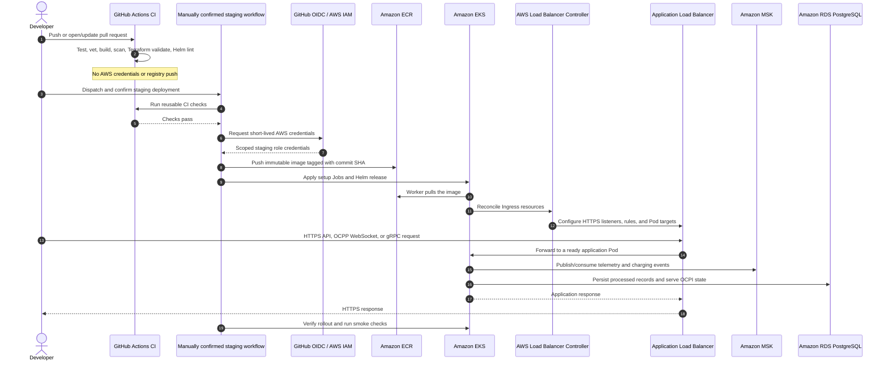

# Device Ingestion Service Stack

This document follows the service from its Go packages through its container,
Kubernetes deployment, CI/CD workflows, and AWS infrastructure. It describes
configuration in this repository; Terraform files and workflow definitions do
not by themselves prove that an AWS environment has been provisioned.

## Implementation status

| Layer | Status in this repository |
| --- | --- |
| Go application and adapters | Implemented: HTTP/OCPI, gRPC, optional OCPP WebSockets, Kafka, and PostgreSQL adapters. |
| Container image | Implemented: multi-stage Linux build, non-root runtime, OCI source labels, and four binaries. |
| Local development | Implemented: Docker Compose and a Minikube profile with local Kafka and PostgreSQL. |
| Kubernetes chart | Implemented: Deployment, ClusterIP Service, probes, setup/smoke Jobs, optional AWS ingress and Secrets Store integration. |
| AWS staging configuration | Terraform and manual-confirmation GitHub deployment workflow exist for EKS, ECR, MSK, RDS, NAT, and ALB-based ingress. Live resource status is not asserted here. |
| AWS learning sandbox | An isolated Terraform root exists for EKS, one candidate worker, ECR, and restricted VPC endpoints. It is documented as **not applied**. |
| Sandbox ECR publishing | Terraform defines a scoped GitHub OIDC publisher role, but no workflow currently assumes that role or pushes to that repository. |

## Application layer

The service uses ports and adapters. `internal/domain` defines telemetry and
charging-event models. `internal/application` implements use cases and ports.
Adapters handle protocols, Kafka, PostgreSQL, and metrics; `app` wires them
together and owns server startup and shutdown (`app/composition.go`,
`app/runtime.go`, `internal/domain`, `internal/application`,
`internal/adapters`).

In the normal `full` profile, startup checks PostgreSQL and Kafka, then starts
HTTP, gRPC, and pprof listeners. It starts the OCPP listener on `:8081` only
when station configuration is present (`app/config.go`, `app/composition.go`).
The HTTP API serves telemetry, health, metrics, and OCPI routes. The gRPC API
accepts telemetry. OCPP 1.6J WebSocket connections publish normalized charging
events; configured OCPI 2.2.1 endpoints expose CPO location data.

Telemetry and OCPP event paths publish to Kafka. Bounded consumer pools validate
and process records, then persist them to PostgreSQL; processing commits Kafka
offsets after database work succeeds. OCPP event processing also handles
duplicates and sends permanent failures to dead-letter topics. OCPI reads
configured location data and persisted connector state
(`internal/adapters/kafka`, `internal/adapters/persistence/postgres`,
`internal/adapters/ocppapi`, `internal/adapters/ocpiapi`). SQL schema changes
are versioned under
[`internal/adapters/persistence/postgres/migrations`](../internal/adapters/persistence/postgres/migrations).

The separate `APP_PROFILE=sandbox` runtime is health-only: it starts HTTP and
gRPC health listeners without PostgreSQL, Kafka, or OCPP. It returns explicit
unavailable responses for disabled operations. It is intended for the isolated
AWS learning exercise, not the full ingestion path (`app/config.go`,
`app/composition.go`).

## Image and Kubernetes layer

`Dockerfile` compiles the server, migration, Kafka initialization, and staging
smoke binaries in a Go build stage. The runtime image contains the binaries,
CA certificates, and timezone data, runs as UID/GID `10001`, and exposes HTTP
8080, OCPP 8081, and gRPC 50051. CI explicitly builds `linux/amd64` images.

The Helm chart in `deploy/kubernetes/device-ingestion` defines:

- A one-replica application Deployment with health probes, resource requests
  and limits, non-root security settings, and a termination grace period.
- A ClusterIP Service for HTTP, gRPC, and optional OCPP ports.
- Jobs to initialize Kafka topics, apply database migrations, and run protocol
  and persistence smoke checks.
- Optional AWS-specific ALB Ingress resources and Secrets Store CSI resources.

The Minikube profile supplies local credentials, single-node Kafka and
PostgreSQL manifests, disables AWS integrations, builds the image inside
Minikube, and runs the Jobs and smoke checks
(`deploy/kubernetes/minikube`, `scripts/minikube-up.sh`). The same Helm chart is
used with different values. The local Kubernetes walkthrough is in
[`minikube-deployment.md`](minikube-deployment.md).

## AWS staging stack

The staging Terraform root is `deploy/aws/staging`. Its configuration defines
these layers:

1. **Network:** one VPC with public and private subnets across two configured
   Availability Zones. A NAT Gateway provides private-subnet outbound access.
2. **Cluster:** EKS control plane and managed worker node group in private
   subnets, with EKS API/audit/authenticator logging configured.
3. **Data services:** Amazon MSK Kafka with TLS and SASL/SCRAM, and private,
   encrypted RDS PostgreSQL. Security groups restrict database and broker
   client ingress to EKS worker nodes.
4. **Image repository:** immutable, scan-on-push ECR repository with a
   lifecycle policy.
5. **Ingress:** the chart declares HTTPS ALB Ingress resources for the API,
   OCPP WebSockets, and gRPC. An operator installs the AWS Load Balancer
   Controller and supplies an ACM certificate and DNS names. The chart does
   not create DNS records.
6. **Identity and secrets:** the EKS OIDC provider and application IAM role
   allow the Kubernetes service account to read selected Secrets Manager
   secrets. The chart's `SecretProviderClass` uses the AWS Secrets and
   Configuration Provider (ASCP) to mount/synchronize values into a
   Kubernetes Secret. The GitHub deployment role uses GitHub OIDC and can
   publish to staging ECR and access the configured EKS cluster.
7. **Logs:** EKS control-plane logs and MSK broker logs are configured for
   CloudWatch. Application output is structured JSON; this repository's
   deployment guide uses `kubectl logs` for application output and does not
   configure an application log forwarder to CloudWatch.

The AWS guide lists the operator-managed prerequisites and deployment steps:
[`aws-staging-deployment.md`](aws-staging-deployment.md). The Terraform source
is split between [`main.tf`](../deploy/aws/staging/main.tf) and
[`eks.tf`](../deploy/aws/staging/eks.tf); application routing and secret
integration are defined in
[`values.yaml`](../deploy/kubernetes/device-ingestion/values.yaml) and the
chart templates.

### Staging delivery flow

Pushes and pull requests run validation only. Staging deployment is manually
dispatched and requires the `confirm_staging_deploy` input; it defaults to
false. When confirmed, the workflow runs CI, assumes the staging AWS role via
GitHub OIDC, builds and pushes an immutable commit-tagged image to ECR,
configures Kubernetes access, runs Kafka initialization and migration Jobs,
upgrades the Helm release, waits for rollout, and runs smoke checks. See
[`ci.yml`](../.github/workflows/ci.yml) and
[`deploy-staging.yml`](../.github/workflows/deploy-staging.yml).

## AWS learning sandbox

`infra/terraform/sandbox` is deliberately separate from staging state and
modules. It defines EKS, a single managed worker candidate, ECR, IAM, and
restricted ECR/EC2/S3 connectivity. It excludes MSK, RDS, NAT, ALB, WAF, and
CloudWatch. Its intended app mode is the health-only sandbox profile, so it
does not provide the full event ingestion behavior. The Terraform README
contains the capacity gate, preliminary cost estimate, plan guard, state
handling, and teardown instructions. The root is currently marked not applied;
do not infer these AWS resources exist.

The sandbox Terraform config creates an OIDC role scoped to ECR publication,
but the current CI workflow does not use it. CI builds and scans an image on
the runner; it does not push to GHCR or ECR. A separate, reviewed publishing
workflow would be needed to send an image to the sandbox ECR repository.

## Configuration and secret boundaries

- **Local Compose:** developer `.env` supplies app configuration and local
  credentials; PostgreSQL and Kafka run as Compose services.
- **Minikube:** ignored `deploy/kubernetes/minikube/credentials.env` is loaded
  into a namespaced Kubernetes Secret; values files point at in-cluster Kafka
  and PostgreSQL services.
- **AWS staging:** Helm values carry non-secret endpoints and identifiers.
  The application service account's IAM role reads selected Secrets Manager
  values through CSI/ASCP.
- **AWS sandbox:** the app is health-only and needs no Kafka/PostgreSQL
  credentials. Workstation API access and GitHub ECR publishing use separate
  IAM roles and separate EKS access boundaries.

Never commit `.env`, local Kubernetes credentials, Terraform state, saved
plans, or real credentials. Terraform state and account configuration are
separate for staging and sandbox.
